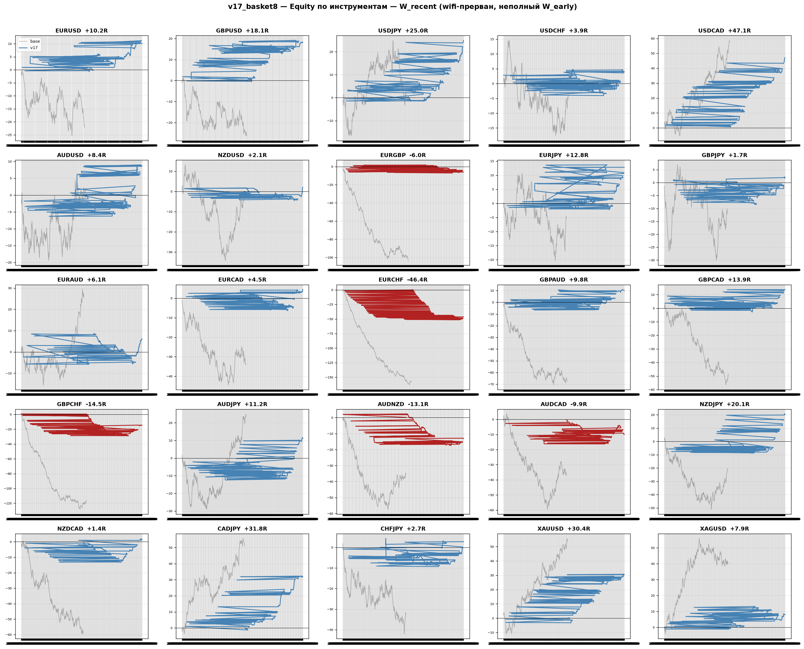
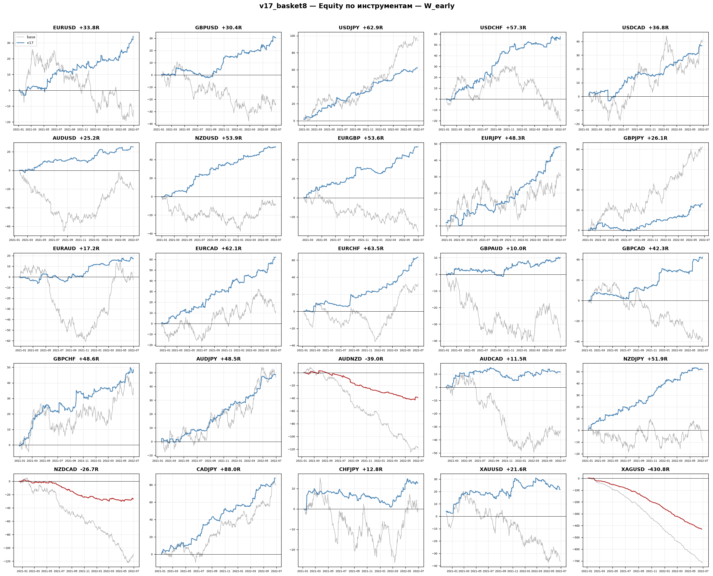
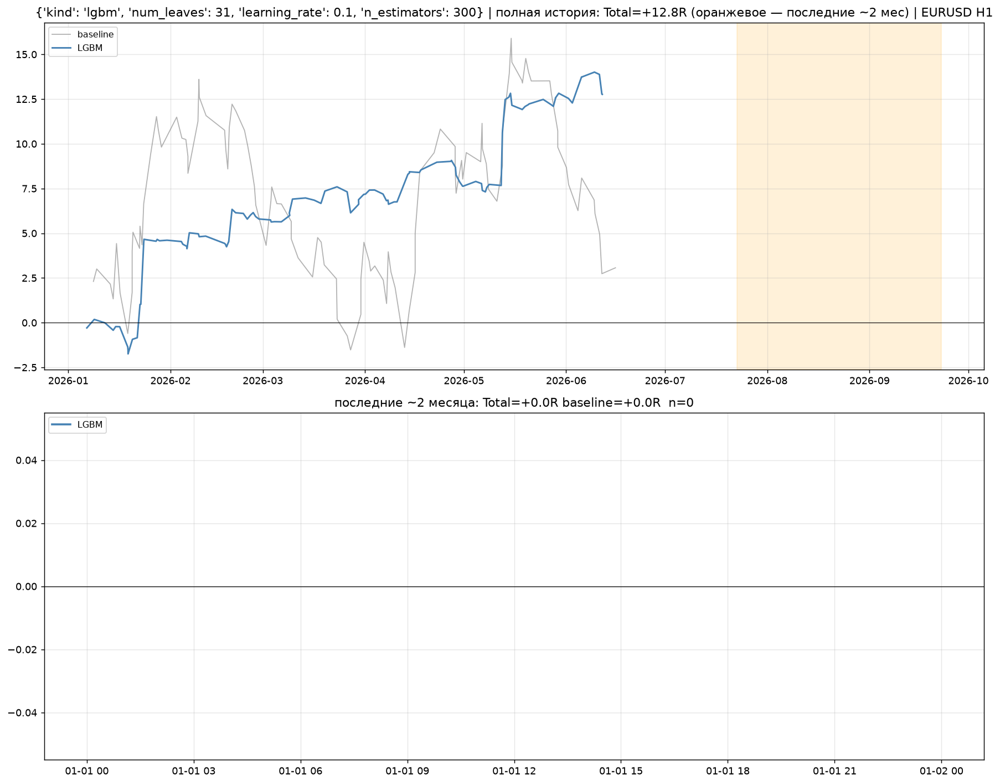
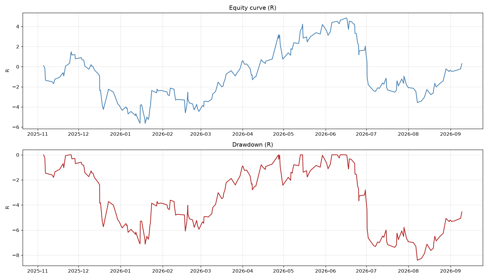
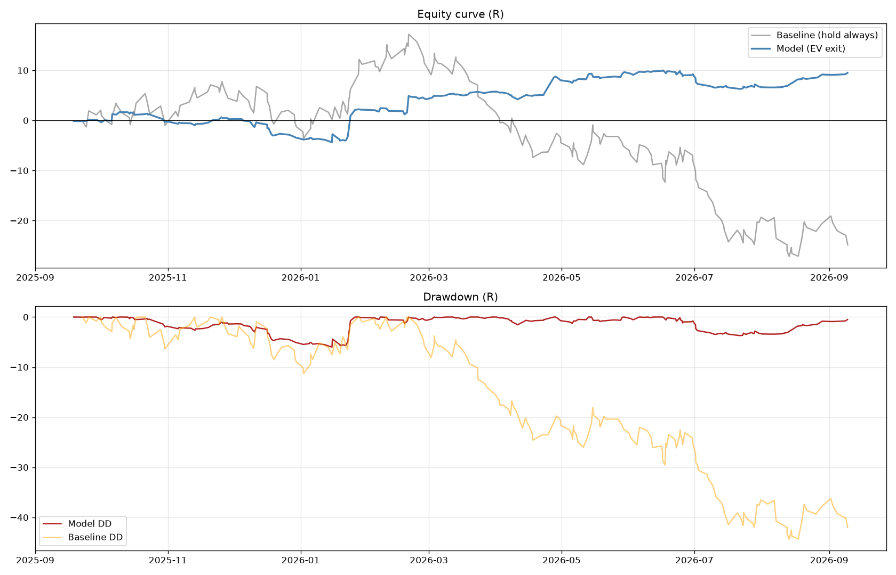
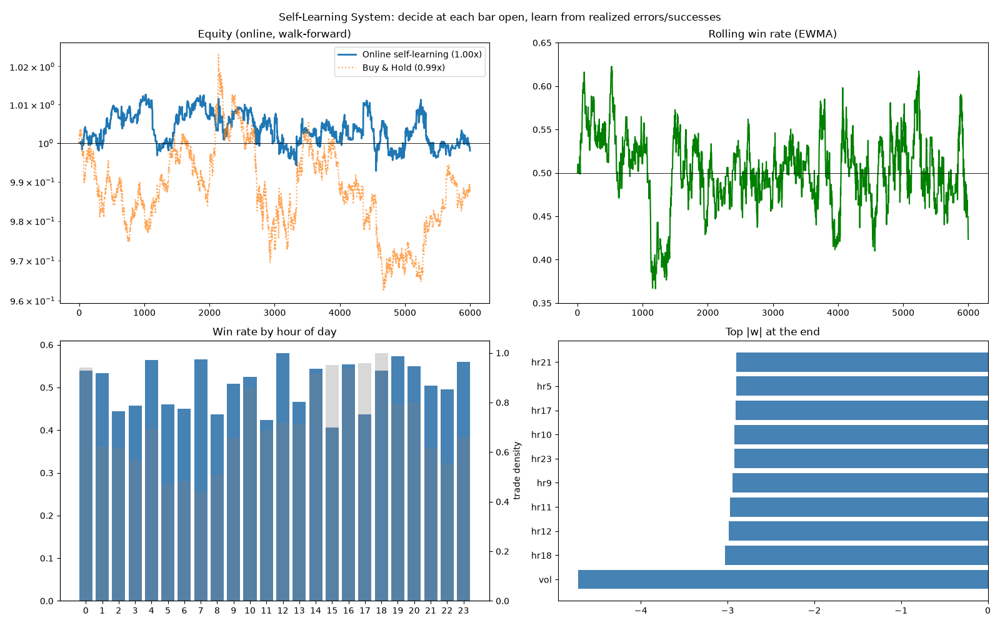
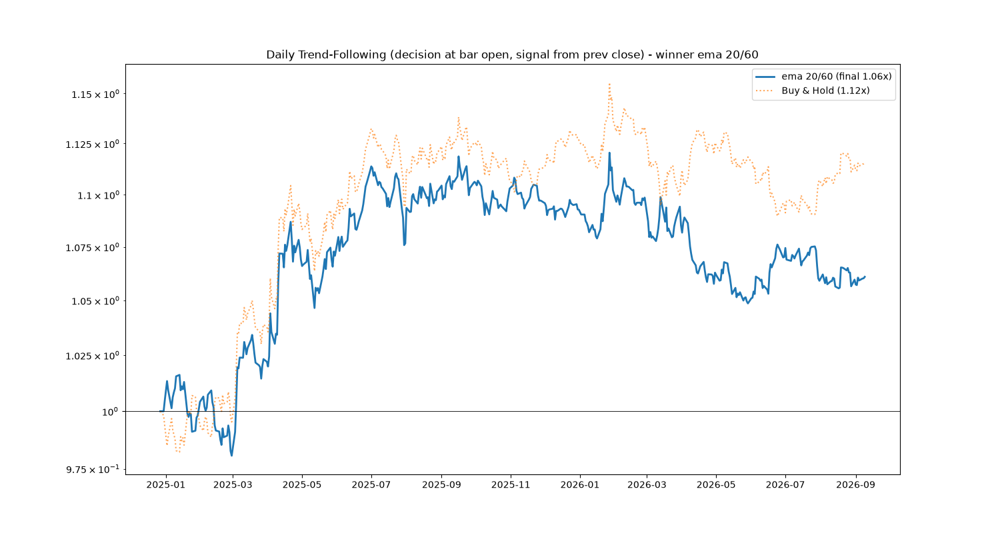

# Первая производная гаусса (gaussian-derivative)

Исследовательский проект на Python: можно ли из истории котировок **каузально предсказать сглажённую первую производную цены** (производную от гауссово сглаживания лог-цены), и как на этом построить торговый движок для форекса H1.

## Описание системы на словах

### 1. Идея

Возьмём лог-цены, прогладим их ядром Гаусса и возьмём производную — получается «медленный, чистый тренд», очищенный от шума. Это цель `y`.

Но такая цель **некаузальна**: чтобы посчитать её в момент `t`, нужны будущие цены (окно ядра лежит вокруг `t`). То есть идеальный тренд мы видим только задним числом.

Вопрос проекта: насколько хорошо **каузальная модель** (на вход — только прошлые лаги лог-доходности, на выход — прогноз производной) способна приблизить этот некаузальный идеал. Потолок качества (`Causal Ceiling`) считается отдельно и служит ориентиром — сравнивается R² модели с потолком.

### 2. Исследовательская линия (main, main2 … main16)

- свёртка цены с ядром `d/dt G_σ` (`scipy.ndimage.convolve1d`), `σ`, длина окна, purge-gap между train и test;
- признаки — 60+ лагов лог-доходности, модель — LightGBM, метрика — R² против потолка;
- поколение за поколением добавлялись: error-feedback (ошибка прошлого шага как признак), rolling/online-обучение, смещение-коррекция, сезонность по часам, forward-таргет, trend-following, варианты окон и стратегий, Optuna-подбор (`main16.py`);
- `analysis.py`, `Untitled-1.py` — разбор того, что предсказуемо, а что нет.

Графики этой линии: `gaussian_derivative_*.png`, `fig_*.png`, `analysis_signals.png`.

### 3. Торговый движок (реактивная система v17)

Гипотеза сместилась: направление предсказывать слабо, а вот **менеджмент сделки поверх пробойных сигналов** даёт системный эффект.

- `reactive_v17.py` — ядро: индикаторы, генерация пробойных входов (lookback 20, стоп 1.5 ATR, rr=2.0, горизонт 12 баров, max_bars 36), состояния, walk-forward, выход по EV-правилу, sizing по кривой `STEEP` (`clip(0.5+(P-0.2)/0.4, 0.5, 1.5)`), vol-gate;
- `v17_basket.py` / `v17_basket8.py` — прогон **25 инструментов × 2 окна** одной конфигурации без подгона под пару, сбор трейдов и графиков эквити;
- `v17_final.py` — робастность: permutation-тесты направления, leave-one-quarter-out, sweep `train_frac`, бутстрап, помесячные разбивки;
- `reactive_study.py`, `reactive_study2.py` — калибровка, sizing, автоподбор, H4-агрегация;
- `v18_lgbm.py` — тот же движок, но классификатор LightGBM/GBC вместо настроенной модели, оптимизация сеткой;
- `Qwen_python_*.py` — независимая проверка: 5 тестов робастности, форвард-сводка, вероятностный выход;
- `прогон-по-всем-инструментам*.py`, `качать-котировки.py` — батч-прогоны и скачивание H1-котировок из MetaTrader 5 в `data/`.

Полные цифры — в [`v17_final_report.txt`](v17_final_report.txt). Ключевой результат: портфель из трёх пар с единой конфигурацией **+69.70R, Sharpe 3.16, DD −11.4** при raw-безуправляемом бэктесте −75.6R; главный рычаг — выход и кривая размера позиции, а не точность ML.

## Примеры графиков эквити

Портфель v17, корзина 25 инструментов, окно W_recent (2024-12 → 2026-09):



То же на раннем окне W_early (2020-01 → 2022-06) — проверка устойчивости:



v18 — система на LightGBM/GBC в движке v17:



Ранние эксперименты с эквити и онлайн-обучением:

| | |
|---|---|
|  |  |
|  |  |

Отчётные графики: `v17_report.png`, `final_report.png`, `robustness.png`, `bootstrap.png`, `v16_optuna_15_champions.png`.

## Структура

| Файл | Назначение |
|---|---|
| `main*.py`, `main-*.py` | линия «предсказание производной Гаусса» и её вариации |
| `reactive_v17.py` | ядро торгового движка (входы, выходы, sizing, walk-forward) |
| `v17_*.py` | корзины, робастность, финальные прогоны, графики |
| `v18_lgbm.py` | версия на LightGBM/GBC |
| `Qwen_python_*.py` | независимые проверки и форвард-сводки |
| `reactive_study*.py`, `check_*.py`, `analysis.py` | калибровка и диагностика |
| `качать-котировки.py` | скачивание H1-котировок MT5 в `data/` |
| `прогон-по-всем-инструментам*.py` | батч по 25 парам, отчёт в `batch_results/` |
| `chair_*.py`, `blender_test.py` | побочные эксперименты (Blender, bpy) |
| `*.png` | графики: эквити, робастность, отчёты |
| `v17_final_report.txt` | итоговый отчёт по системе |

Не выгружено в репозиторий (через `.gitignore`): `.venv/`, `__pycache__/`, котировки `data/` (155 МБ) и CSV/NPY с результатами прогонов — котировки восстанавливаются скриптом `качать-котировки.py`.

## Запуск

```bash
pip install numpy pandas scipy scikit-learn lightgbm matplotlib optuna
```

1. Скачать данные: `python "качать-котировки.py"` (нужен MetaTrader 5) — появится папка `data/`.
2. Исследование: `python main.py`.
3. Торговая система: `python v17_basket8.py` → трейды и графики эквити `v17_basket8_equity_*.png`.
4. Итоги и робастность: `python v17_final.py`, отчёт `v17_final_report.txt`.

## Disclaimer

Исследование на исторических данных (backtest, in-sample по ряду проверок). Не является инвестиционной рекомендацией.
